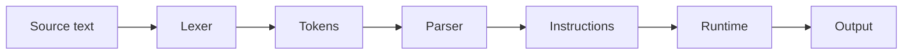
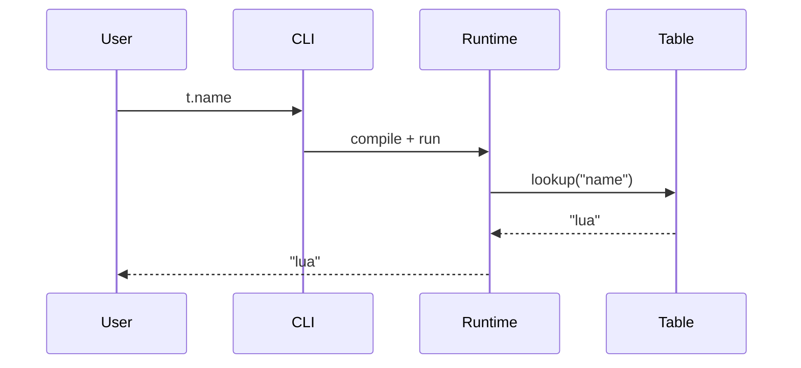
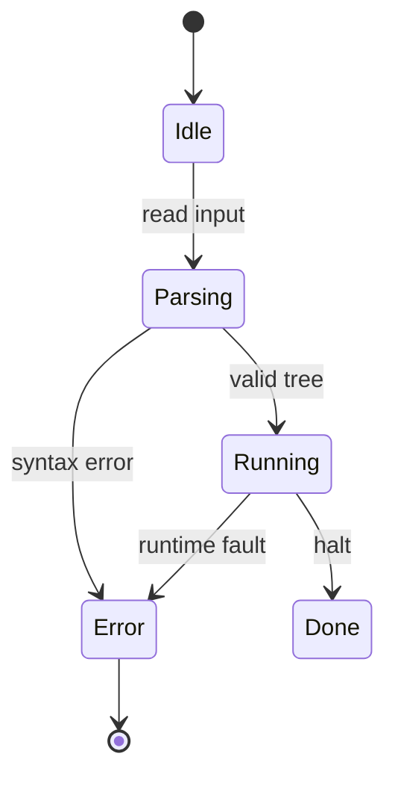
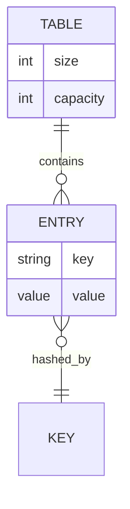
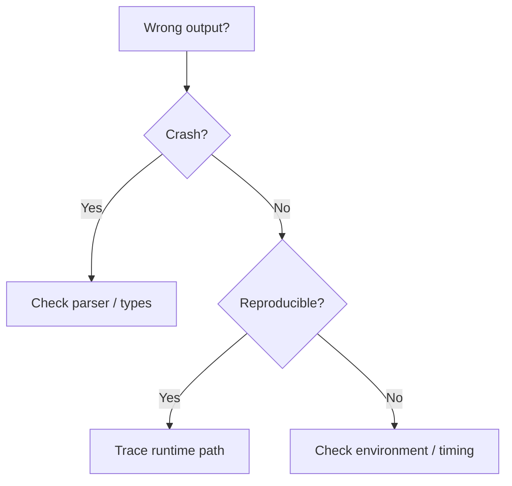

# Diagrams First

A course is a sequence of pictures with annotations, not a sequence of paragraphs with occasional pictures. Mermaid is the default drawing tool because it is text, diffable, themeable, and renderable offline.

## The rule

- **Every conceptual screen leads with a visual.** Mermaid is the default; code↔English translations, annotated code, tables, and hand-built diagrams are valid alternatives when Mermaid would distort the idea.
- **Every teaching section has at least one Mermaid diagram.** The diagram carries the section’s core idea; the prose annotates it.
- **Every module has at least three Mermaid diagrams and at least two diagram types.** A four-module course therefore has 12+ diagrams. Scale the count with the module count.
- **If a sentence describes a flow, sequence, state, hierarchy, decision, dependency, or relationship, draw it.** “Because X, then Y” is a flowchart. “A calls B, then C” is a sequence. “A is a B” is a class/ER diagram. “It depends on Z” is a graph.
- **Prose after a diagram is 2–3 sentences.** The caption says what to notice; the body adds the “why,” not a restatement of every node.
- **A diagram must change what the learner can do.** If it is decorative, delete it.
- **One idea per diagram.** 12 nodes is the practical ceiling; split a larger map into two screens.

The visual ratio is not “50% visual.” It is **graph-first**: the default screen is a diagram plus a short annotation, and a text-only screen is a defect unless it is a deliberate transition or a short quote.

## Minimums by track

| Track | Mermaid diagrams / module | Types / module | Max nodes | Annotation |
|---|---|---|---|---|
| Newcomer | 3 | 2 | 8 | One sentence per highlighted node |
| Explorer | 3 | 2 | 10 | One sentence + one analogy |
| Builder | 3 | 2–3 | 12 | “What to notice” + failure edge |
| Deep Diver | 3–4 | 3 | 12 | Dense labels, edge conditions, fallback path |

These are floors, not targets. A concept-heavy module can use five small diagrams instead of one large one.

## Choose the diagram type

| The learner needs to see | Use | Mermaid type |
|---|---|---|
| The whole machine: stages and boundaries | A left-to-right system map | `flowchart LR` |
| An end-to-end trace: who calls whom, in order | Actors as stages, arrows as calls/returns | `sequenceDiagram` |
| A lifecycle: created → ready → running → done | States and transitions | `stateDiagram-v2` |
| Data shape: records, keys, relationships | Entities, attributes, cardinality | `erDiagram` |
| Types, traits, inheritance, composition | Classes and relationships | `classDiagram` |
| A decision or troubleshooting path | Diamonds with labelled branches | `flowchart TD` |
| A hierarchy or taxonomy | Parent → child map | `flowchart TB` or `mindmap` |
| A history or evolution | Ordered eras/steps | `timeline` |
| A trade-off between two forces | Four quadrants with labelled axes | `quadrantChart` |
| A schedule or dependency order | Tasks and dependencies | `gantt` (use rarely) |
| A small proportion breakdown | Up to five slices | `pie` (use rarely) |

Do not use a flowchart for a sequence, a sequence diagram for a static structure, or a pie chart for more than five slices. The diagram type is part of the explanation.

## Core patterns

### System map

Use for the opening “whole machine” screen. Label each node with the project’s real stage name and put the one-line responsibility on the edge or in a caption, not inside a paragraph.



### End-to-end trace

Use for “follow one line/one action.” Keep the participants to 3–5; put the concrete input in a note, not in the title.



### State and failure path

Use when the concept is a lifecycle or an error mode. Every failure transition gets a label.



### Data shape

Use for runtime modules. Mark keys and cardinality; do not draw every field.



### Decision / troubleshooting

Use for “where should I look first?” screens. The branches are the lesson; the prose explains the evidence.



## The screen pattern

```html
<section class="screen" id="s-02-01">
  <h2 class="screen-heading">Where the value comes from</h2>

  <figure class="diagram diagram-wide">
    <pre class="mermaid">
      flowchart LR
        A[Source] --> B[Tokens] --> C[Tree] --> D[Value]
    </pre>
    <figcaption>Follow the edge labelled <code>eval</code>; it is where the tree becomes a value.</figcaption>
  </figure>

  <p>2–3 sentences that explain the one edge the caption points at.</p>

  <div class="micro-check" data-check="predict-02-01">
    <!-- one predict/reveal or one-question check -->
  </div>
</section>
```

The caption is mandatory. It tells the learner **what to notice**, not what the diagram is. “This is the pipeline” is not a caption; “The value is created at the last edge, not in the parser” is.

## Make diagrams interactive

Static diagrams are the baseline. Add one interaction only when it teaches the path:

- **Step-through:** 3–5 “Next” steps highlight one node or edge at a time. Useful for a trace or a request lifecycle.
- **Click to reveal:** clicking a node opens its real code line, one-line responsibility, or error example. Useful for a system map.
- **Hover/focus annotation:** focusable nodes show a short definition. Never make hover the only way to get information.
- **Predict the edge:** ask which edge fires for a given input before highlighting it.

Implementation rules:

- Keep the Mermaid source in the page; render to SVG locally.
- Toggle a `classDef active` on node IDs after render; do not re-render Mermaid on every step.
- Provide Previous/Next buttons, a “show all” control, and a static fallback that is readable with JavaScript disabled.
- Keyboard: buttons are real `<button>` elements; nodes get `tabindex="0"` and `role="button"` only if they actually do something.
- Do not use an interaction that hides the whole diagram behind a click.

## Theme and layout

Bundle Mermaid locally. Initialize once, with the white course palette:

```js
mermaid.initialize({
  startOnLoad: false,
  theme: 'base',
  themeVariables: {
    primaryColor: '#FFFFFF',
    primaryTextColor: '#111318',
    primaryBorderColor: '#B83A1F',
    lineColor: '#5F6673',
    secondaryColor: '#F3F4F6',
    tertiaryColor: '#FDF0EC',
    clusterBkg: '#F7F7F8',
    clusterBorder: '#D7DADF',
    fontFamily: 'DM Sans, sans-serif',
    fontSize: '15px',
  },
});
```

- Diagram width up to 1000–1100 px; fixed-size wrapper with `overflow-x: auto` for wide maps.
- If the course uses a requested theme, map these Mermaid variables to that theme’s palette instead of the white values above.
- Node labels ≤4 words; edge labels ≤3. Put detail in the caption or a `<details>`.
- Use `flowchart LR` for pipelines, `flowchart TD` for decisions, and keep one direction per diagram.
- Do not use the default purple Mermaid theme, rainbow node colors, or emoji.
- Do not put a paragraph inside a node. Split the idea or annotate outside the diagram.

## Accessibility and fallback

- `<figure>` + `<figcaption>`; the caption is the accessible summary.
- Give the SVG `role="img"` and an `aria-label` that names the diagram’s point.
- Put the Mermaid source in a `<details><summary>Diagram source</summary>` block for screen readers, copy/paste, and debugging.
- Verify the rendered SVG is not blank and has text; a failed render often leaves an empty `<svg>`.
- Test at 375 px: the page must not overflow; the diagram wrapper may scroll horizontally.
- Ensure node text and edge labels meet 4.5:1; the white theme above does.
- Respect `prefers-reduced-motion` for step-through highlights.

## Quality checklist

- [ ] Every teaching section has at least one diagram, and at least one screen is diagram-led.
- [ ] Every module meets its diagram floor and uses at least two diagram types.
- [ ] Every diagram has a one-sentence “what to notice” caption.
- [ ] Every diagram maps to a section objective or a lab decision.
- [ ] No diagram duplicates another diagram in the same module.
- [ ] No diagram exceeds 12 nodes; wide diagrams scroll inside their wrapper.
- [ ] Every arrow is labelled when the label changes the meaning.
- [ ] The Mermaid theme matches the white course palette.
- [ ] Every diagram renders with visible text, not a blank SVG.
- [ ] The source fallback and `aria-label` are present.
- [ ] The page still reads with JavaScript disabled.

## Anti-patterns

- Six sentences describing a process that should be a four-node flowchart.
- A diagram that only restates the section title.
- An unlabelled arrow that leaves the learner guessing what flows.
- A 25-node “complete architecture” diagram on one screen.
- A decorative Mermaid diagram next to a text wall.
- Reusing the same diagram in three sections with different captions.
- Hiding the only copy of the information in a hover state.
- Using a screenshot of a diagram where editable Mermaid source belongs.
